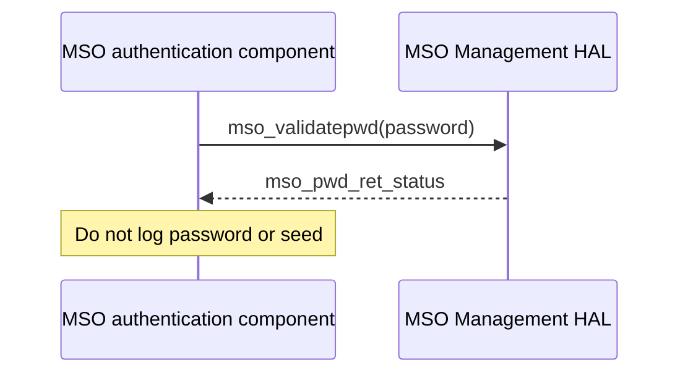

# MSO Management HAL Specification

## Version History

| Date | Comment | Version |
| --- | --- | --- |
| — | Documentation alignment; no ABI change. | — |

## Acronyms
HAL means Hardware Abstraction Layer; MSO means Multiple System Operator; PoD means Password of the Day.

## Description
The MSO authentication component uses this HAL to validate the daily password and set or retrieve its seed.

## Optional Components
Seed storage and on-demand decryption are platform integrations, not selectable public APIs.

## Component Runtime Execution Requirements
### Threading Model
Serialize password/seed access unless the vendor guarantees concurrency.
### Process Model
The functions are in-process library calls. Coordinate shared seed changes across processes.
### Memory Model
Callers own password and seed buffers. The set/get comments require at least 64 bytes for seed storage. The legacy `SIZE_arrisCmDevHttpClientSeed` macro says eight and is not a safe replacement for the documented buffer requirement. The retrieval buffer MUST be manually overwritten after use.
### Internal Error Handling
Do not apply integer status rules to password validation: it returns `mso_pwd_ret_status`. Seed operations return `RETURN_OK` (`0`) or `RETURN_ERR` (`-1`).
### Persistence Model
Seed retrieval refers to configuration storage or the associated SNMP OID. Durability, atomicity, and rollback are not otherwise specified.

## Nonfunctional Requirements
### Logging and Debugging
Implementations must not log credentials, secrets, security-sensitive information, or other sensitive data. Log operation outcomes rather than payloads.
### Quality Control
Use static analysis and memory tools. Test status handling without publishing secret fixtures.
### Licensing
See repository Apache-2.0 notices.
### Build Requirements
Include the public header and link the vendor implementation; legacy packaging names `libhal_msomgmt.so`.
### Variability Management
Confirm the product's seed storage/decryption behavior.

## Interface API Documentation
| Function | Contract |
| --- | --- |
| `mso_pwd_ret_status mso_validatepwd(char *pwd)` | Validates the password; returns `Invalid_PWD`, `Good_PWD`, `Unique_PWD`, `Expired_PWD`, or `TimeError`. Interpret `Unique_PWD` using the vendor contract. |
| `INT mso_set_pod_seed(char *pSeed)` | Sets the seed. Newer broadband devices MUST decrypt the seed on demand when called. |
| `INT mso_get_pod_seed(char *pSeed)` | Retrieves/decrypts the seed into caller storage. Follow Memory Model for capacity and erasure. |

### Theory of Operation and Key Concepts
A password-validation enum is not a Boolean. Clock-related failure is a distinct result. The API lacks a seed-length argument, so termination, accepted seed encoding, and exact output length must be agreed with the implementation.

### Sequence Diagram

## Source References
- [mso_mgmt_hal.h](https://github.com/rdkcentral/rdkb-halif-mso/blob/develop/include/mso_mgmt_hal.h)
